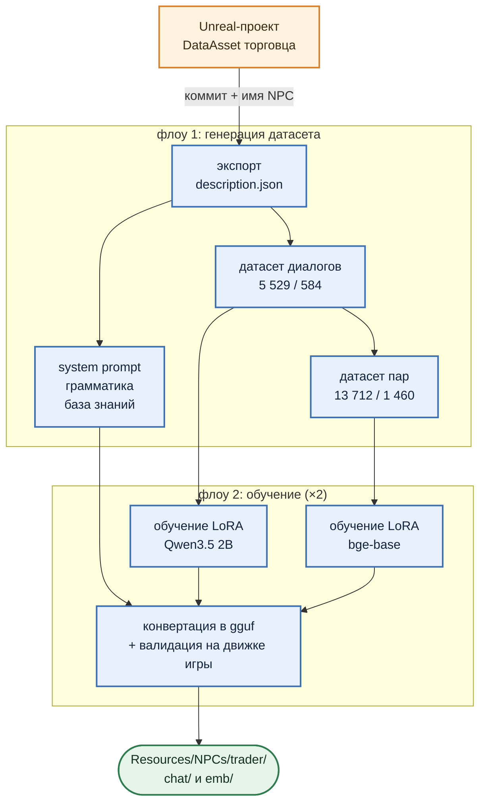

# 1. Общая картина

***

## Что на входе и что на выходе

На вход пайплайн получает два аргумента: коммит Unreal-проекта и имя NPC. Больше ему ничего знать не нужно: всё, что описывает торговца, уже лежит в его DataAsset в этом коммите.

На выходе получается папка, содержимое которой копируется в `Resources/NPCs/trader/` игрового проекта:

* `chat/lora.gguf` — адаптер диалоговой модели, 21 МБ;
* `chat/inference_cfg.json` — system prompt, GBNF-грамматика, параметры семплинга;
* `emb/lora.gguf` — адаптер embedding-модели для базы знаний, 5 МБ;
* `emb/knowledge_base.json` — сама база знаний, 53 намерения.

Плюс отчёт с метриками "до и после", по которому решается, стоит ли это вообще копировать.

***

## Схема

Пайплайн состоит из двух флоу Prefect: генерация датасета и обучение. Второй запускается дважды, по разу на каждый адаптер.

Экспорт — единственное место, где пайплайн трогает Unreal. Редактор запускается без интерфейса (`UnrealEditor-Cmd.exe -run=pythonscript`), python-скрипт внутри него загружает реестр NPC и сохраняет `description.json`: тот же JSON, который в игре отдаёт `UNPCDataRegistry::GetNpcDataJson`, и дальше Unreal не нужен до самого конца.

Второго адаптера в планах части 2 не было. По ходу работы выяснилось, что базовая embedding-модель путает "покажи категорию" с "продай предмет из неё" в 51 запросе из 292, и база знаний без собственного адаптера работает хуже, чем хотелось бы (подробнее в [разделе 5](section-05-train-emb.md)).

***

## Стек

Всё локально, как и в игре. Prefect 3 как оркестратор; Ollama с Qwen3 4B для генерации текста; transformers + PEFT + TRL для обучения диалогового адаптера и sentence-transformers для адаптера эмбеддингов; скрипты `llama.cpp` для конвертации в gguf; MinIO для хранения артефактов. Валидация идёт через python-биндинги к тем же DLL, что лежат в плагине ULlama — об этом [раздел 6](section-06-validation.md).

Железо то же, что у демо: RTX 5070 Ti на 16 ГБ. Игра и обучение живут на одном компьютере.

***

Дальше по порядку: как из DataAsset получается датасет, что ещё из него собирается, как обучаются оба адаптера, как они проверяются и как всё это версионируется.

***

## Заметки автора (удалить перед склейкой)

- **"Второй запускается дважды"** - формально это два разных флоу (`train-lora-adapter-4-ue-npc` и `validation-lora-adapter-4-ue-npc` для эмбеддингов), но для читателя разница несущественна. Если хочется точности - "два флоу обучения, по одному на адаптер".
- **Ollama с Qwen3 4B** - `qwen3:4b-instruct` на обоих проходах генерации; qwen3:8b для описаний намерений в прогоне v2 не использовался.
- **"Один компьютер"** - если обучение шло на другой машине, поправить здесь и в разделе 4.
- Список выходных файлов повторяет раздел 7, это намеренно: читатель должен с первого раздела знать, ради чего всё.
