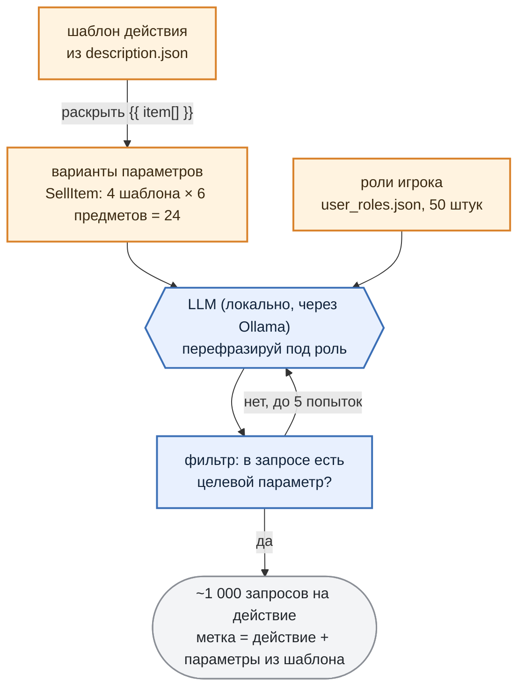

# 2. Датасет из DataAsset

Чтобы обучить адаптер, нужны тысячи примеров "запрос игрока -> правильный ответ NPC". Писать их руками под каждого персонажа мы как раз не хотели.

Ни одна реплика в датасете не написана человеком. Всё собирается из `description.json`, того же JSON, который игра читает из DataAsset торговца. Разница только в том, что игра берёт из него характер и список действий, а пайплайн — ещё и **шаблоны**, по которым эти действия можно размножить.

***

## Шаблон действия

Каждая запись `ActionData` в DataAsset устроена как шаблон, из которого разворачивается целая серия ситуаций:

```json
{
  "ActionTemplate":   "SellItem({{ item[] }})",
  "RequestTemplate":  "Could you sell me the {{ item_it }} for defence from monsters?",
  "UsrStateTemplate": "User has {{ rand_range(100, 500) }} gold",
  "NpcStateTemplate": "Item: {{ item_it }}, Cost: {{ rand_range(50, 99) }} gold, Amount: {{ rand_range(1, 10) }}",
  "Parameters": {
    "item": ["pistol", "assault_rifle", "shotgun", "revolver", "sniper_rifle", "rocket_launcher"]
  }
}
```

Это Jinja с несколькими своими операторами:

* `{{ item[] }}` — цикл: шаблон разворачивается по одному разу на каждый элемент списка;
* `{{ item_it }}` — текущий элемент цикла;
* `{{ rand_range(a, b) }}` — случайное число, чтобы состояния не повторялись;
* `{{ join(list) }}` — список в строку через запятую (для категорий: "pistol, shotgun, revolver...").

Из записи выше получается шесть ситуаций, по одной на предмет, с разным количеством золота и разной ценой. Шаблон для `NotEnoughGoldToBuy` отличается от неё одной строкой: `rand_range(0, 49)` вместо `rand_range(100, 500)`. Для `OutOfStock` — `Amount: 0`. Больше никакой логики "когда какое действие уместно" в пайплайне нет: она целиком задана этими диапазонами.

**Имя действия и параметры приходят из шаблона и дальше не меняются.** LLM будет генерировать текст, но целевую метку она не трогает.

***

## Из шаблона — в живую речь

Шаблонный запрос "Could you sell me the pistol for defence from monsters?" для обучения бесполезен: игрок так не говорит. Нужны десятки формулировок одной и той же просьбы, и здесь подключается LLM.



**Роли игрока** — второй источник разнообразия. В `user_roles.json` лежат пятьдесят персонажей с описанием и стилем речи: Rookie Survivor (*nervous, hesitant, polite*), Gang Leader (*dominant, threatening, confident*), Field Medic (*calm, focused, professional*). Для каждой пары "роль × вариант параметров" LLM получает шаблонный запрос, описание торговца, описание роли и просьбу переписать запрос так, как сказал бы этот человек.

Один и тот же `SellItem(pistol)` в итоге звучит и как "Um, I'm not sure I can handle a gun, but... would you be able to sell me a pistol?", и как "Pistol. Now. I don't have all day."

Размер выборки подбирается решателем: `роли × перефразы × варианты ≈ целевое число на действие`, и при выборе решатель предпочитает больше ролей, а не больше перефразов от одной роли. Для торговца это дало **43 роли по одной формулировке на вариант**, около тысячи запросов на каждое из шести действий.

Проверка результата нарочно примитивная: если в сгенерированной фразе нет целевого параметра как подстроки (слова "pistol" для `SellItem(pistol)`), фраза отбраковывается и генерация повторяется. Умнее не нужно: проверка ловит тот единственный случай, когда LLM увлеклась ролью и забыла про предмет.

***

## Негативные примеры

Действие `DoNothing` из части 2 отвечает за запросы вне компетенции торговца, и чтобы модель её выучила, в датасете должны быть такие запросы. Генерируются они тем же способом, но с перевёрнутым промптом: сгенерируй просьбы, на которые этот NPC *не может* ответить по роли. Те же пятьдесят ролей, ~1 000 запросов, метка `DoNothing` с пустыми параметрами. Состояние игрока и склада у таких записей пустое: для ответа "это не ко мне" контекст не нужен.

***

## Ответ NPC

На этом шаге у каждой записи есть запрос, контекст и правильное действие, но нет текста ответа и эмоции. Их дописывает второй проход LLM.

Модели передаётся запрос игрока, его роль, описание торговца и **действие, которое NPC уже выбрал**. Решение уже принято шаблоном, модели остаётся его озвучить: одно-два предложения в характере торговца плюс тег эмоции из пяти допустимых.

Для "Would you sell me that pistol? I don't want to get caught off guard." получается `Happy` и "Sure! That pistol is just what you need. Here you go!". Для `NotEnoughGoldToBuy` — что-нибудь сочувственное и `Sad`.

***

## Одна запись от шаблона до датасета

| Стадия | Что добавилось |
|---|---|
| Шаблон | `SellItem({{ item[] }})`, "Could you sell me the {{ item_it }}..." |
| Раскрытие | `SellItem(pistol)`, "User has 386 gold", "Item: pistol, Cost: 50 gold, Amount: 3" |
| Перефраз под роль | Rookie Survivor: "Would you sell me that pistol? I don't want to get caught off guard." |
| Ответ NPC | `Happy`, "Sure! That pistol is just what you need. Here you go!" |
| Запись датасета | три сообщения: system / user / assistant |

Последняя стадия — формат, который понимает тренер:

```json
{"messages": [
  {"role": "system",    "content": "<system prompt торговца из раздела 3>"},
  {"role": "user",      "content": "{\"request\": \"Would you sell me that pistol?...\", \"usr_state\": \"User has 386 gold\", \"npc_state\": \"Item: pistol, Cost: 50 gold, Amount: 3\"}"},
  {"role": "assistant", "content": "{\"emotion\": \"Happy\", \"answer\": \"Sure! That pistol is just what you need. Here you go!\", \"action\": {\"name\": \"SellItem\", \"parameters\": {\"item\": \"pistol\"}}}"}
]}
```

В `user` лежит тот же JSON, который игра отправляет модели ([раздел 1 части 2](https://habr.com/ru/articles/TODO/)), в `assistant` — тот, который игра ждёт в ответ.

***

## Обучающая и валидационная выборки

Делим **по ключу "действие + параметры"**, без случайной выборки по всему датасету: из каждой группы (`SellItem` с `pistol`, `SellItem` с `shotgun_ammo`, ...) откладываем 10% в валидацию. Иначе при шести действиях и двух десятках предметов легко получить валидацию, в которой `rocket_launcher` не встречается вовсе, и ошибку на нём никто не заметит.

Для торговца: **5 529** записей на обучение, **584** — на валидацию. В обучение валидационные записи не попадают, по ним считаются цифры в [разделе 6](section-06-validation.md).

***

**Коротко:** шаблон из DataAsset разворачивается в варианты параметров, умножается на роли игрока и перефразируется локальной LLM. Метка (действие + параметры) приходит из шаблона и не меняется, текст пишет LLM. Около тысячи записей на действие, разметка без шума по построению.

***

## Заметки автора (удалить перед склейкой)

- **Проход "описание намерения"** (`STEP_2_GENERATE_ACTION_DESC` через qwen3:8b) в прогоне v2 выключен - `actions_desc.json` пустой для всех действий, кроме `DoNothing`. В раздел не включён. Если планируете его включать, он ложится между "Из шаблона в живую речь" и "Ответ NPC".
- **Модели генерации:** оба прохода - `qwen3:4b-instruct` через Ollama. В тексте написано "локальная LLM" без названия; добавить, если хотите подчеркнуть, что датасет для 2B делала модель на 4B.
- **Размер:** в `.env` стоит `DATASET_SIZE_PER_ACTION=100`, а в `0_generate_usr_requests/` лежит ~1 000 на действие (файлы пишутся в режиме append). Какое значение реально дало v2 - уточнить; в тексте "около тысячи" по факту содержимого.
- **Время генерации** двух проходов (≈ 6 000 + 6 000 вызовов LLM) - в репозитории не логируется. Хорошо бы одну цифру.
- **tool-calling вариант** датасета (`3_dataset/tool_calling/`) генерируется параллельно, но в игре не используется - в раздел не включён.
- **Ссылка на часть 2** в блоке про формат записи - заменить `TODO` на реальный URL после публикации.
- Диапазоны `rand_range` в шаблонах торговца: золото 100-500 / 0-49, цена 50-99. Вся разница между `SellItem` и `NotEnoughGoldToBuy` - в одном диапазоне; это хороший момент, его оставил.
