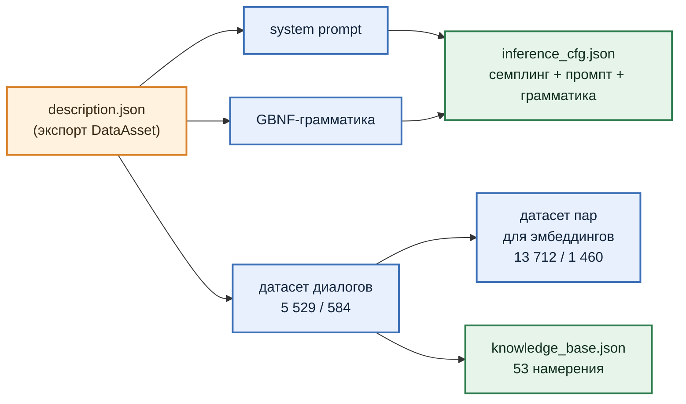

# 3. Всё остальное тоже собирается из DataAsset

В части 2 мы обещали рассказать, как устроен генератор, который из DataAsset делает system prompt и грамматику. Пора выполнить обещание: датасет из [раздела 2](section-02-dataset.md) не единственный артефакт, который пайплайн собирает из `description.json`. Из того же файла, тем же прогоном, собирается всё, что игра загружает для торговца.

Зелёным отмечено то, что уезжает в игру как есть, синим — промежуточные артефакты: датасеты идут на обучение, а промпт и грамматика вклеиваются в конфиг инференса.

***

## System prompt и грамматика

System prompt торговца, который в части 2 лежал под спойлером, никто не писал руками. Это Jinja-шаблон, общий для всех NPC, в который подставляются две вещи из DataAsset: описание персонажа (имя, специализация, характер) и **правила действий**. Правила собираются автоматически: имя каждого действия, его параметры и списки допустимых значений (`AllowedParameters_item`, `AllowedParameters_category`) берутся из тех же записей `ActionData`, из которых разворачивался датасет. Новый предмет, добавленный торговцу в DataAsset, одним прогоном попадает в датасет, промпт и грамматику.

Грамматика собирается ещё проще. Её каркас (структура JSON с тремя полями) одинаков для всех NPC, меняются две строки: перечень допустимых эмоций и перечень допустимых действий. Эмоции приходят из плагина, действия — из DataAsset. Отсюда ноль ошибок формата в [разделе 6](section-06-validation.md): грамматика не даст модели выдать имя действия, которого нет в DataAsset.

Промпт и грамматика склеиваются с шаблоном параметров семплинга (`temp 0.3`, `top_k 40`, `top_p 0.8`, контекст 4 096 токенов) в `inference_cfg.json`. После обучения в него допишутся два пути, к базовой модели и к `lora.gguf`, и этот файл игра кладёт в `FULlamaInferenceConfig`.

Один и тот же system prompt идёт и в датасет (как поле `system` каждой записи), и в конфиг инференса, так что модель обучается на том промпте, с которым потом работает.

***

## База знаний

База знаний для семантического поиска из части 2 тоже собирается здесь. Источник для неё — уже готовый датасет диалогов.

Датасет диалогов группируется по ключу "действие + параметры", и из каждой группы берётся одна запись. Её сигнатура, каноническая строка вида `SellItem | item: shotgun`, становится текстом чанка, а действие с параметрами служит ключом к поставщику контекста. Для торговца таких уникальных комбинаций **53**: 24 предмета для `SellItem`, те же 24 для `ShowItem` и 5 категорий для `ShowItemsByCategory`.

Три действия из шести в базу не попадают: `NotEnoughGoldToBuy`, `OutOfStock` и `DoNothing`. Причина та же, что во врезке про поле `action` в части 2: игрок не *просит* "откажи мне в продаже". Он просит продать, а отказать или нет — решает LLM по контексту `usr_state` и `npc_state`. Намерение у всех трёх одно — `SellItem`, и в базе оно уже есть. У `DoNothing` намерения нет по определению.

На этой же строке, `SellItem | item: shotgun`, в [разделе 5](section-05-train-emb.md) обучается адаптер эмбеддингов.

***

**Коротко:** из одного `description.json` за один прогон собираются system prompt, GBNF-грамматика, конфиг инференса, два датасета и база знаний из 53 намерений. Промпт и грамматика собираются по шаблону из записей `ActionData`, база знаний — дедупликацией датасета по ключу "действие + параметры". Отказы и `DoNothing` в базу не входят: игрок их не просит, их выбирает модель по контексту.

***

## Заметки автора (удалить перед склейкой)

- **Поле в JSON базы знаний.** В части 2 в листинге поле называлось `intention`, в файле `Resources/NPCs/trader/emb/knowledge_base.json` оно называется `signature`. В тексте раздела слово "сигнатура" без имени поля; при склейке решить, не поправить ли листинг в части 2 (она уже опубликована, так что скорее оставить как есть).
- **tool-calling промпт.** Шаг 2 генерирует ещё и второй system prompt под tool-calling формат (`tool_calling_sp.txt`, `tool_calling_inference_cfg.json`). В игре не используется, на схему не вынесен.
- **Конфиг эмбеддингов.** `embedding_inference_cfg.json` тоже пишется этим шагом (шаблон с `k_retrieve`, `hybrid_search` и т.д.), но пока это пустая заготовка. На схеме не показан, чтобы не множить стрелки.
- **"Эмоции приходят из плагина"** - список `emotions` импортируется из `ullama_python`, то есть из биндингов к плагину. Формулировка верна.
- **Семплинг в конфиге:** `temp 0.3, top_k 40, top_p 0.8, repeat_penalty 1.2, n_ctx 4096, n_predict 128`. В тексте три первых, чтобы не перегружать.
