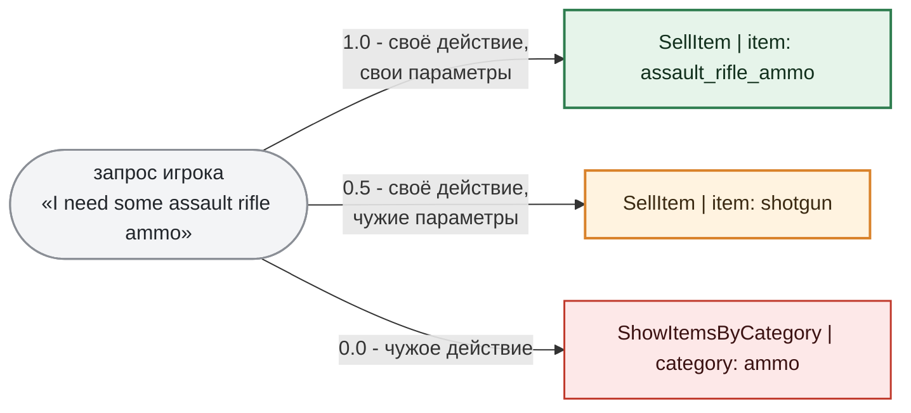

# 5. Обучение адаптера эмбеддингов

Этот раздел неожиданный: RAG обычно "просто работает" (взял готовую embedding-модель, проиндексировал документы, ищешь), и мы тоже так думали, пока не посчитали промахи.

***

## Зачем

База знаний торговца - это 53 намерения, и большинство из них похожи друг на друга как близнецы: `SellItem | item: pistol` и `ShowItem | item: pistol` отличаются одним словом. Запросы игроков похожи ещё сильнее: "есть что-нибудь из медикаментов?" и "продай аптечку" для необученного эмбеддера лежат рядом, потому что в обоих про лечение.

Валидация базовой `bge-base-en-v1.5` на 292 запросах показала **63 промаха (21.6%)**, и 51 из них - на `ShowItemsByCategory`. Модель не отличает "покажи категорию" от "дай конкретный предмет из этой категории". Для игры это значит, что каждый пятый запрос получает не тот контекст, и LLM отвечает про аптечку, когда игрок спрашивал про весь прилавок с лекарствами.

Промпт здесь не поможет: у embedding-модели его нет. Остаётся дообучить её на наших парах, и это второй адаптер, который пайплайн собирает из того же датасета.

***

## Пары с тремя уровнями близости

Обучение эмбеддингов - это обучение на парах "текст A, текст B, насколько они близки". Пары собираются из датасета диалогов [раздела 2](section-02-dataset.md): первый элемент - запрос игрока, второй - сигнатура намерения из базы знаний, оценка - одна из трёх:

На каждый запрос - одна пара с оценкой 1.0, до двух пар с 0.5 и до двух с 0.0. Для торговца это **13 712 обучающих пар** из 2 759 запросов и 1 460 валидационных из 292. Валидационные запросы - те же, что потом пойдут в [раздел 6](section-06-validation.md).

Средний уровень 0.5 - самое важное в этой схеме. Без него модель выучила бы только "своё или чужое", а нам нужно, чтобы `SellItem | item: shotgun` был ближе к запросу про дробовик, чем `ShowItemsByCategory | category: weapons`, но дальше, чем `SellItem | item: shotgun_ammo`. Функция потерь CoSENT как раз умеет работать с такими градациями: она штрафует модель за нарушение порядка пар, абсолютное значение косинуса её не интересует.

***

## Грабля, ставшая решением

Первая версия пар выглядела иначе: вторым элементом был **другой запрос игрока** с тем же действием. "Продай пистолет" ↔ "Дай ствол, быстро" с оценкой 1.0. Логично: учим модель, что разные формулировки одной просьбы близки.

Проблема в том, что оба текста написаны LLM, и ни один из них не является тем, что лежит в базе знаний. Если во втором запросе модель-генератор увлеклась ролью и написала "Дай что-нибудь стреляющее", пара с оценкой 1.0 учит эмбеддер неправильному. А главное - на инференсе запрос сравнивается с сигнатурой `SellItem | item: pistol`, которую модель при обучении не видела ни разу.

Переход на сигнатуры убрал обе проблемы разом. Второй элемент пары - детерминированная строка из имени действия и параметров, в ней нечему шуметь. И это **та же самая строка, что лежит в базе знаний** из [раздела 3](section-03-artifacts.md): обучение и поиск видят одинаковые тексты.

***

## Чекпойнт выбирается не по loss

Обучение короткое: bge-base в 110 миллионов параметров, LoRA ранга 16 на слои внимания, батч 64, lr 2e-4, запас в 10 эпох с early stopping. На деле остановка произошла на 650-м шаге из 2 140 запланированных, а лучший чекпойнт - 500-й; всё вместе заняло несколько минут.

Интересно, *как* выбирался лучший. Loss на валидации у эмбеддеров плохо предсказывает качество поиска: он может расти, пока top-1 улучшается, и наоборот. Поэтому после каждых 50 шагов валидационные запросы прогоняются через настоящий retrieval по всем 53 сигнатурам, и чекпойнт выбирается по доле запросов, у которых правильная сигнатура оказалась первой - `accuracy@1`. На базовой модели она 0.58, на 500-м шаге - 0.94. Loss при этом между 450-м и 650-м шагом успел и упасть, и вырасти обратно, не сдвинув `accuracy@1` с места.

Дальше та же конвертация, что в [разделе 4](section-04-train-llm.md): `lora.gguf` на 5 МБ рядом с `knowledge_base.json` в `Resources/NPCs/trader/emb/`.

***

**Коротко:** базовый эмбеддер промахивается на каждом пятом запросе, потому что не различает "покажи категорию" и "дай предмет". Адаптер учится на 13 712 парах "запрос ↔ сигнатура намерения" с тремя уровнями близости, причём сигнатура - буквально та строка, что лежит в базе знаний. Лучший чекпойнт выбирается по `accuracy@1` настоящего поиска, а не по loss. Результат - 5 МБ.

***

## Заметки автора (удалить перед склейкой)

- **Цифры:** пары 13 712 / 1 460 (по оценкам 2 703 / 5 500 / 5 509 в обучении); запросов-якорей 2 759 / 292; `accuracy@1` по шагам: 0.575 (50) → 0.887 (200) → 0.938 (500), дальше плато 0.935-0.938 до остановки на 650. "На базовой модели 0.58" - это замер на 50-м шаге, не на нулевом; если хочется точности, написать "после первых 50 шагов" или убрать.
- **Loss между 450 и 650:** 4.01 → 4.02 → 3.50 → 4.11 → 4.46 при `accuracy@1` 0.918 → 0.938 → 0.935 → 0.935 → 0.938. Утверждение в тексте верно.
- **Время обучения** - все чекпойнты записаны в одну минуту (17:38), общая длительность по меткам не восстанавливается. "Несколько минут" - оценка; eval занимает ~1 с.
- **Префикс запроса** `Represent this sentence for searching relevant passages: ` (стандартный для BGE) добавляется к запросу и при обучении, и при поиске; он уезжает в `inference_cfg.json` как `query_prefix`. В раздел не включён - деталь.
- **Мидл-пары "свои параметры / чужие"** - для `ShowItemsByCategory` пять категорий, поэтому "до двух" мид-пар всегда набирается; для действий с 24 предметами тоже. Формулировка "до двух" из кода (`pairs_per_level: 2`).
- **Пример на схеме** - реальная пара из `training/SellItem.jsonl` (запрос про assault rifle ammo). Строки с 0.5 и 0.0 подобраны для наглядности из того же файла.
- **Ссылка на раздел 8** из раздела 4 про коллатор - там же будут "loss ≠ accuracy@1" и warmup с 128 эпохами. Здесь про warmup не сказано, чтобы не дублировать.
