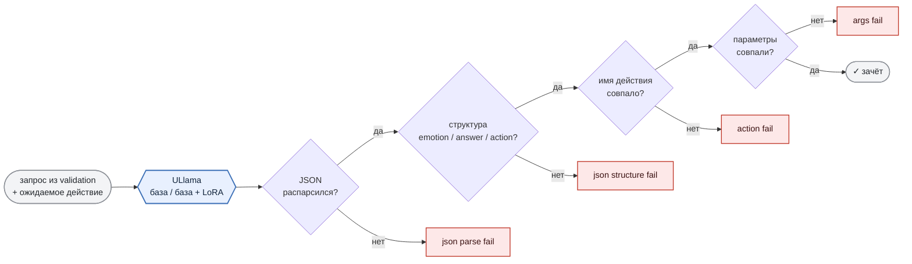

# 6. Валидация на том же движке, что и игра

Адаптер обучен и сконвертирован в `lora.gguf`. Прежде чем класть его в игру, надо понять, стало ли лучше и насколько.

Проверять это внутри обучающего пайплайна (transformers + PEFT) бессмысленно: в игре модель крутится в `llama.cpp` через плагин ULlama, с GBNF-грамматикой и своими параметрами семплинга. Разница в движке и в грамматике легко даёт расхождение в несколько процентов, а мы как раз охотимся за процентами.

Валидация идёт через **`ullama_python`**, python-биндинги к тем же DLL, что лежат в плагине (`ullama.dll`, `ggml-cuda.dll`), с тем же system prompt, грамматикой и конфигом инференса, что потом уедут в `Resources/NPCs/trader/`. Цифры ниже показывают то, что увидит игрок.

***

## Как считаем

Валидационная выборка состоит из тех 10% записей из [раздела 2](section-02-dataset.md), которые в обучение не попали: по каждому действию и каждой комбинации параметров отложено поровну. Для торговца это 584 записи, в прогон берём до 100 на действие, итого **580 запросов**.

Каждый запрос прогоняется дважды: базовая модель без адаптера и та же модель с `lora.gguf`. Ответ проверяется по цепочке, и запрос засчитывается как ошибка на первом же провалившемся шаге:

Сравнение строгое: параметры должны совпасть с ожидаемыми целиком, и `item: "shotgun"` вместо `item: "shotgun_ammo"` засчитывается как ошибка.

***

## Диалоговая модель: до и после

Базовая модель — та самая **Qwen3.5 2B** из части 2, в fp16, без квантизации.

| Метрика | База | LoRA |
|---|---:|---:|
| **Ошибок всего** | **381 (65.7%)** | **10 (1.7%)** |
| JSON не распарсился | 0 | 0 |
| Неверная структура JSON | 0 | 0 |
| Неверное действие | 346 (59.7%) | 9 (1.6%) |
| Неверные параметры | 35 (6.0%) | 1 (0.2%) |

Две трети ответов базовой модели ошибочны. Интереснее разложить ошибки по действиям:

| Действие | База | LoRA |
|---|---:|---:|
| `NotEnoughGoldToBuy` | 96 из 96 | 0 |
| `OutOfStock` | 93 из 96 | 0 |
| `ShowItem` | 55 из 96 | 0 |
| `DoNothing` | 44 из 100 | 0 |
| `SellItem` | 29 из 96 | 8 |
| `ShowItemsByCategory` | 29 из 100 | 1 |

Базовая модель **ни разу не отказала в продаже**. Во всех 96 случаях, когда у игрока не хватало золота, она выбирала `SellItem`; при пустом складе — то же самое в 93 случаях из 96. Контекст `usr_state` и `npc_state` она видела, но решение принимала по тексту просьбы. Это то самое поведение, которое в части 2 мы ловили на видео с попыткой развести торговца и которое промпт с инструкцией "STRICT parameter rules" починить не смог.

После адаптера у обоих действий ноль ошибок. Оставшиеся 10 промахов почти все на `SellItem`, где модель изредка выбирает `ShowItem` вместо продажи: граница между "покажи" и "продай" в живой речи действительно размыта.

> **А если взять модель побольше?** Тот же прогон на Qwen3 4B: база ошибается в 39.1% случаев, с адаптером — в 0.2%. После дообучения 2B отстаёт от 4B на полтора процента, а памяти и времени на ответ требует вдвое меньше. Для игры, где рядом живут ещё три модели и рендер, этого хватило, чтобы остаться на 2B, как и было решено в части 2.

***

## Эмбеддинги базы знаний: до и после

База знаний из части 2 ищет намерение игрока по косинусной близости, и у неё свой адаптер, значит, нужна и своя проверка.

Схема та же: запрос из валидационной выборки прогоняется через embedding-модель, берутся два ближайших чанка базы с косинусом выше 0.75. Зачёт — если хотя бы один из них ведёт к ожидаемому действию с теми же параметрами. В базе только три действия, по которым есть намерение (`SellItem`, `ShowItem`, `ShowItemsByCategory`), поэтому запросов здесь **292**.

| Действие | База (bge-base) | LoRA |
|---|---:|---:|
| `ShowItemsByCategory` | 51 (17.5%) | 2 (0.7%) |
| `ShowItem` | 9 (3.1%) | 0 |
| `SellItem` | 3 (1.0%) | 2 (0.7%) |
| **Всего** | **63 (21.6%)** | **4 (1.4%)** |

Почти все промахи базы — на категориях. Для необученного эмбеддера "есть что-нибудь из медикаментов?" и "продай аптечку" лежат рядом: в обоих про лечение. После адаптера модель различает "покажи категорию" и "дай конкретный предмет", потому что видела тысячи таких пар с разными оценками близости ([раздел 5](section-05-train-emb.md)).

***

## Что это значит для схемы из части 2

JSON-ошибок в первой таблице **ноль** и у базы, и у адаптера.

Это закрывает вопрос, который в части 2 остался открытым. GBNF-грамматика держит форму ответа полностью: за 1 160 прогонов модель ни разу не выдала невалидный объект или объект не той структуры. На смысл грамматика не влияет, базовая модель с идеальной формой ошибалась в двух третях случаев, и за смысл отвечает адаптер.

***

**Коротко:** валидация идёт на тех же DLL, что в игре, с той же грамматикой и конфигом. Диалоговая модель: 65.7% -> 1.7% ошибок, базовая ни разу не умела отказать в продаже. Эмбеддинги: 21.6% -> 1.4%. JSON-ошибок ноль в обоих случаях — форму держит грамматика, смысл чинит LoRA.

***

## Заметки автора (удалить перед склейкой)

- **Семплинг.** В игре и в валидации `temp: 0.3` - подтверждено автором, расхождения нет. Фраза "тот же конфиг инференса" в третьем абзаце верна буквально.
- **График.** `img/actions_metrics_chart.png` скопирован из `reports/` прогона `6be4f75`. Ось Y там до 580 при максимуме столбика 96 - график читаемый, но полупустой; возможно, стоит перерисовать с осью до 100.
- **Ссылки на разделы 2 и 5** - относительные, при склейке заменить на якоря.
- **4B с историей** (база 12%, LoRA 39.8%) намеренно не здесь, а в разделе 8 "Грабли".
- **"1 160 прогонов"** = 580 × 2.
