# 7. Версионирование и доставка

Через полгода у торговца будет пятый DataAsset, третий датасет и десяток адаптеров. Кто-то спросит, из чего сделан `lora.gguf`, который сейчас в игре, и ответ должен лежать рядом с файлом.

***

## Путь артефакта как его паспорт

Все артефакты прогона лежат по пути, в котором закодировано всё, от чего они зависят:

```text
input_data/
└── 7c01ee7/                    # коммит Unreal-проекта, из которого экспортирован DataAsset
    └── trader/                 # NPC
        └── v2/                 # идентификатор прогона генерации датасета
            ├── description.json
            ├── 3_dataset/chat/              # датасет диалогов
            ├── 3_embedding_dataset/action_signature/
            ├── knowledge_base.json
            └── training/
                ├── lora/<базовая модель>/chat/6be4f75/
                │   ├── lora.gguf, inference_cfg.json, manifest.json, reports/
                └── lora_embedding/<модель эмбеддингов>/action_signature/f2e08a7/
                    ├── lora.gguf, inference_cfg.json, knowledge_base.json, manifest.json
```

Последний сегмент пути (`6be4f75`) — хеш гиперпараметров обучения: ранг, α, learning rate, эпохи, batch. Поменяли один параметр, получили другую папку. Запустили с теми же, и пайплайн увидит, что папка есть, и обучать заново не станет. Так эксперименты с гиперпараметрами не затирают друг друга.

***

## Манифест

Путь отвечает на вопрос "откуда", но не на вопрос "что внутри". На него отвечает `manifest.json`, который заводится на первом шаге и дописывается каждым следующим:

```mermaid
flowchart LR
    S0["экспорт DataAsset"]
    S1["датасет"]
    S2["обучение"]
    S3["конвертация"]
    S4["валидация"]

    S0 -- "коммит Unreal,<br/>коммит пайплайна,<br/>NPC, прогон, время" --> S1
    S1 -- "+ размер выборок<br/>по действиям" --> S2
    S2 -- "+ базовая модель,<br/>гиперпараметры" --> S3
    S3 -- "+ пути к gguf" --> S4
    S4 -- "+ метрики<br/>база / LoRA" --> M[("manifest.json")]

    classDef step fill:#e8f0fe,stroke:#3b6fb6,stroke-width:2px,color:#12243b
    classDef out fill:#e6f4ea,stroke:#2e7d4f,stroke-width:2px,color:#12301d
    class S0,S1,S2,S3,S4 step
    class M out
```



В итоге рядом с каждым `lora.gguf` лежит файл, по которому можно восстановить всю цепочку: коммит `7c01ee7` Unreal-проекта, коммит `17cabfd` пайплайна, 5 529 записей на обучение, ранг 16, и что на валидации вышло 10 ошибок из 580. Таблицы из [раздела 6](section-06-validation.md) взяты из поля `validation` манифеста прогона `6be4f75`.

Два коммита в манифесте нужны, чтобы отвечать на вопрос "почему адаптер стал хуже". Если изменился коммит Unreal, значит, изменился DataAsset, и это вопрос к геймдизайнеру. Если изменился коммит пайплайна, вопрос к нам.

***

## Куда это уезжает

После валидации последний шаг флоу выгружает в S3-хранилище (MinIO) адаптер, манифест, конфиг инференса, базу знаний, отчёт и графики — по тому же пути, что на диске. Параллельно те же вещи регистрируются как артефакты Prefect: ссылка на адаптер, отчёт в markdown и три графика. Отчёт и графики видны прямо в интерфейсе флоу, без похода в хранилище.


***

## Честно про ручную часть

Последний метр пайплайна пока ручной. Четыре файла (`lora.gguf` и `inference_cfg.json` для диалоговой модели, `lora.gguf` и `knowledge_base.json` для эмбеддингов) копируются в `Resources/NPCs/trader/{chat,emb}/` Unreal-проекта руками. В первоначальном плане был git-hook: коммит DataAsset запускает флоу, флоу кладёт артефакты в хранилище, игра при сборке их оттуда забирает. Первые две трети этого плана работают по кнопке, последняя треть — по `Ctrl+C`, `Ctrl+V`.

Причина простая: для одного NPC и двух человек кнопка пока быстрее, чем триггер, который надо написать, отладить и не забыть выключить, когда DataAsset правят десять раз за вечер.

***

**Коротко:** артефакты лежат по пути `<коммит Unreal>/<NPC>/<прогон>/.../<хеш гиперпараметров>`, рядом с каждым — манифест, который накапливает всё от коммитов до метрик. Всё это уезжает в MinIO и в артефакты Prefect. Копирование в проект игры пока ручное.

***

## Заметки автора (удалить перед склейкой)

- **Скриншот Prefect UI** `img/prefect_artifacts.png` - его нет, надо снять: страница прогона `train-lora-npc-trader-v2` с вкладкой Artifacts (ссылка `lora-model`, отчёт `lora-training-report`, три графика). Если снимать не хочется, абзац работает и без картинки.
- **Хеш гиперпараметров** для LLM считается из `num_train_epoch, lora_rank, lora_alpha, learning_rate, gradient_accumulation, warmup_ratio` (+ batch); для эмбеддингов ещё из loss, префикса, seed и warmup_steps. В тексте перечень сокращён.
- **"Пайплайн увидит, что папка есть, и обучать заново не станет"** - так в коде тренера эмбеддингов (`already exists, skipping`). Для LLM-тренера проверить, что та же логика; если нет - смягчить до "можно сделать".
- **Бакет** `interactive-npc-lora-models`, ключ в S3 совпадает с относительным путём на диске. В тексте без имени бакета.
- **Отдельный флоу для эмбеддингов** (`validation-lora-adapter-4-ue-npc`) и выгрузка его артефактов через тот же `step_3_save_artifacts`. В разделе оба адаптера описаны одной фразой "по тому же пути".
- **DVC** из `MLOPS.md` в тексте не упомянут вообще - его не было в реализации.
- **Конфиг эмбеддингов в игре** (`Resources/NPCs/trader/emb/inference_cfg.json`) сейчас указывает на базовую модель и адаптер **абсолютными путями в репозиторий пайплайна** (`D:/Projects/Python/...`), а не на скопированные файлы. То есть "копируются руками" верно для `chat`, а для `emb` файлы вообще не копируются. Перед публикацией либо поправить конфиг в игре, либо честно написать.
- **"Два человека"** в последнем абзаце - если команда другого размера, поправить.
